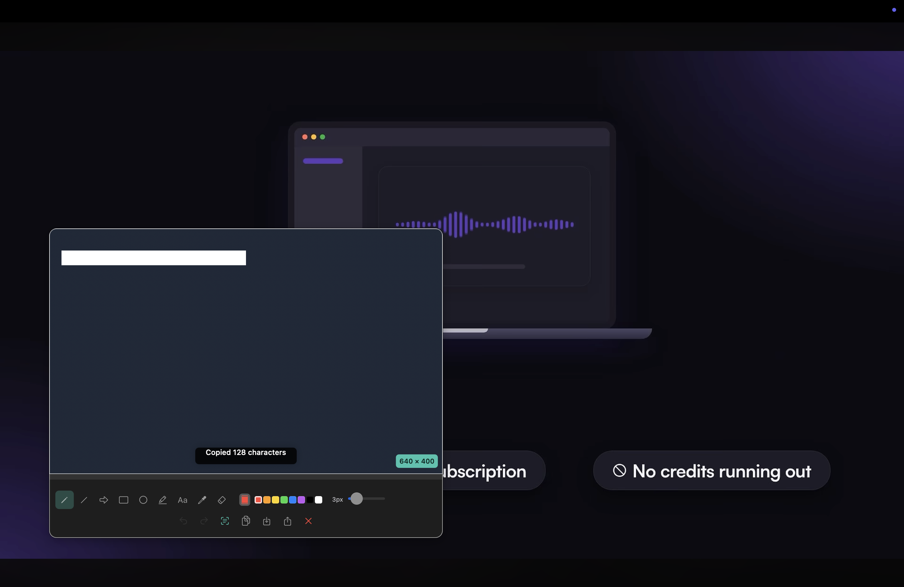
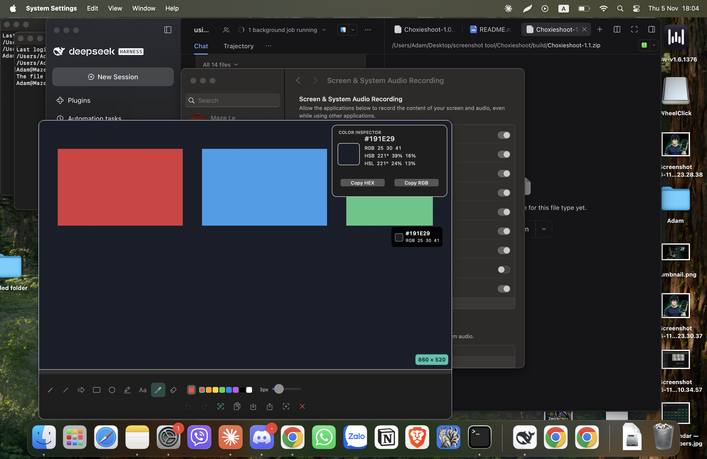
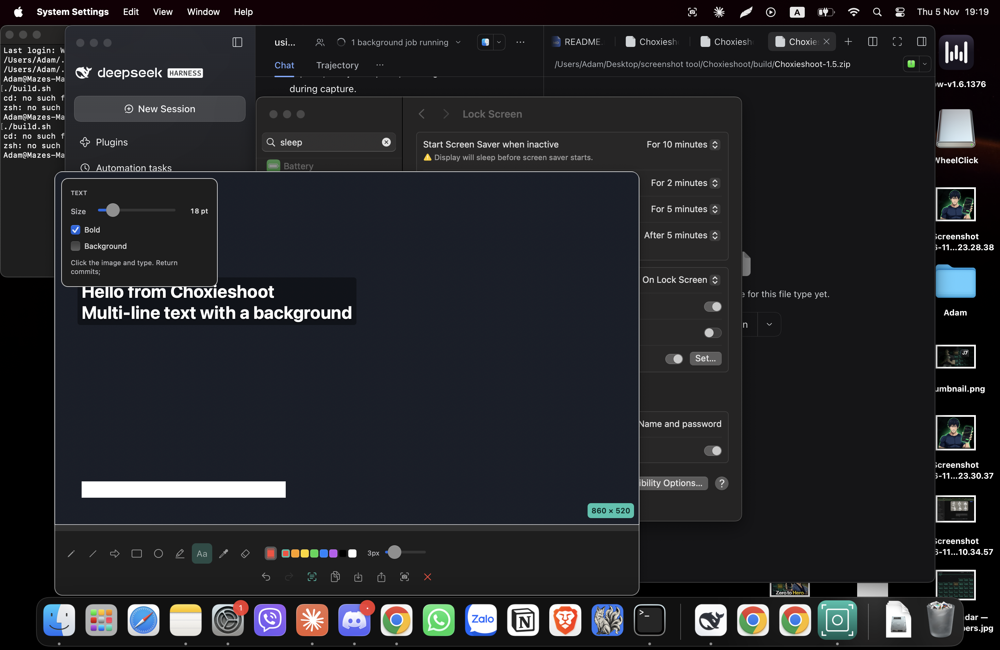
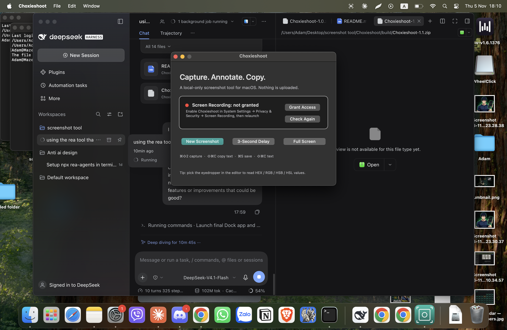

# Choxieshoot

[](https://apple.com/macos)
[](LICENSE)
[](https://github.com/Choxie77/Choxieshoot/releases)
[](https://github.com/Choxie77/Choxieshoot/actions)

A lightweight, native Lightshot-style screenshot and screen recording utility for macOS. Built with pure Objective-C and Cocoa — zero external dependencies, ultra-fast launch, 100% offline, and privacy-first.

The app lives in your Dock and menu bar, captures any screen region with a dimmed drag-selection overlay, and opens a responsive floating editor with an extensive suite of annotation tools, on-device OCR, and a video recording studio with built-in trimming, cropping, rotation, and GIF export.

---

## 📸 Screenshots

| Annotation Editor | Eyedropper & Color Inspector |
|---|---|
|  |  |

| Multi-line Text Tool | Launcher & Permissions |
|---|---|
|  |  |

---

## Quick Start

### 📦 Download Prebuilt
1. Download **`Choxieshoot.dmg`** or **`Choxieshoot-1.8.zip`** from [GitHub Releases](https://github.com/Choxie77/Choxieshoot/releases).
2. Open the DMG and drag **Choxieshoot** into your **Applications** folder.
3. Launch the app and grant Screen Recording access in macOS System Settings when prompted.

### 🛠️ Or Build From Source
```bash
git clone https://github.com/Choxie77/Choxieshoot.git
cd Choxieshoot
./build.sh
open build/Choxieshoot.app
```
*Requires Xcode Command Line Tools (`xcode-select --install`). No third-party dependencies, no Node, no package manager.*

---

## Features

### 📸 Screenshot & Annotation Suite
- **Region, Fullscreen & Delayed Capture** — ⌘⇧2, menu bar, launcher, or Dock menu. Dimmed crosshair overlay with live dimension badge and corner drag handles.
- **Floating Responsive Editor** — Automatically adapts between single-row and two-row toolbars depending on capture size; hugs your screenshot with zero wasted margins.
- **Full Annotation Suite** — Pencil, line, arrow, rectangle, ellipse, highlighter, text, eyedropper, callout numbers, pixelate/blur, and eraser.
- **Color Tools** — 8-color quick palette + macOS native color panel; 1–20 px stroke width slider.
- **Rich Text Tool** — Multi-line text annotations with live sizing, 10–72 pt font sizes, bold styling, optional solid background, and drop shadow for maximum legibility on any background.
- **Eyedropper & Color Inspector** — Hover any pixel for a live HEX/RGB loupe under your cursor. Color Inspector panel displays **HEX, RGB, HSB, and HSL** with one-click copy buttons.
- **On-Device Vision OCR** — Extract text directly from screenshots to your clipboard (⇧⌘C) using Apple Vision; multi-column reading order detection with toast feedback and cancel support.
- **One-Click Save & Copy** — Save directly to disk (⌘S) with an optional *"Also copy to clipboard"* checkbox, or copy annotated images straight to your pasteboard (⌘C).
- **Undo / Redo History** — Full snapshot history including eraser deletions (⌘Z / ⇧⌘Z).

### 🎥 Video Studio & Recording (v1.8)
- **Region Video Recording** — Capture designated screen regions into smooth H.264 `.mp4` video.
- **Microphone Audio** — Optional microphone recording for voiceovers and tutorials.
- **Motion Blur & Cursor Tracking** — Configurable shutter motion blur (Subtle, Cinematic, Heavy) and cursor smoothing.
- **Built-in Timeline Trimmer** — Non-destructive in-app video trimming, cropping, and instant preview before export.
- **Animated GIF Export** — Convert any recorded clip directly into an animated `.gif` with customizable framerate.
- **Video Rotation & Speed** — Rotate video 90° clockwise, adjust playback speed (0.5x, 0.75x, 1x, 1.25x, 1.5x, 2x), and toggle audio muting.
- **Still Frame Capture** — Extract full-resolution still frames directly from video playback to your clipboard or disk.

### 🔒 Privacy & Performance
- **100% Local & Offline** — No cloud accounts, no background analytics, no telemetry, and zero network calls.
- **Native Cocoa / Objective-C** — Zero electron/web bloat. Instant startup, tiny memory footprint, and low CPU usage.
- **Smart Permission Diagnostic** — Probes real window capture access to avoid false-negative TCC permission traps on ad-hoc builds.

---

## Keyboard Shortcuts

| Shortcut | Action |
|---|---|
| ⌘⇧2 | Capture screen region |
| ⌘N | New screenshot from editor |
| ⌘S | Save PNG / MP4 |
| ⌘C | Copy image / video to clipboard |
| ⇧⌘C | Copy text via OCR |
| ⌘Z | Undo |
| ⇧⌘Z | Redo |
| Esc | Close editor / cancel selection / cancel OCR |
| Drag background | Move the editor window |

---

## Building & Testing

### Compile
```bash
./build.sh
```
This builds `build/Choxieshoot.app`, `build/Choxieshoot-1.8.zip`, and `build/Choxieshoot.dmg`.

Frameworks used: `Cocoa`, `Carbon`, `CoreGraphics`, `CoreImage`, `Vision`, `AVFoundation`, `AVKit`, `CoreMedia`, `CoreVideo`, `UniformTypeIdentifiers`.

### Run Self-Tests
```bash
B="build/Choxieshoot.app/Contents/MacOS/Choxieshoot"
"$B" --selftest      # Capture + renderer + undo/redo
"$B" --ocrselftest   # Vision OCR reading order & detection
"$B" --ocrflowtest   # OCR to clipboard pipeline
"$B" --drawtest      # Synthetic drawing & pixel assertions
"$B" --copytest      # Image pasteboard copy
"$B" --savetest      # Image compositing to PNG
"$B" --videotest     # Video recording, trimmer, crop, rotation, GIF & frame export
```

---

## Project Structure

```
Choxieshoot/
├── build.sh                     # Compile + bundle + DMG installer creation
├── LICENSE                      # MIT License
├── README.md                    # Project documentation & screenshots
├── CONTRIBUTING.md              # Contributor guidelines
├── SECURITY.md                  # Security & privacy policy
├── .github/
│   ├── workflows/ci.yml         # GitHub Actions macOS CI pipeline
│   ├── ISSUE_TEMPLATE/          # Bug report & feature request templates
│   └── PULL_REQUEST_TEMPLATE.md # Pull request template
├── Choxieshoot/                 # Application source code
│   ├── main.m                   # Entry point + test mode dispatcher
│   ├── AppDelegate.{h,m}        # App lifecycle, status bar item, hotkeys, dock menu
│   ├── SelectionWindow.{h,m}    # Dimmed full-screen selection overlay
│   ├── EditorWindow.{h,m}       # Floating annotation editor window
│   ├── CanvasView.{h,m}         # Screenshot canvas, annotation rendering, eyedropper
│   ├── ToolbarView.{h,m}        # Responsive action and toolbars
│   ├── ColorInspectorView.{h,m} # HEX/RGB/HSB/HSL color inspector
│   ├── LauncherWindow.{h,m}     # Main launcher & permission manager
│   ├── PreferencesWindow.{h,m}  # App preferences & recording settings
│   ├── VideoRecorder.{h,m}      # AVFoundation screen & audio recording engine
│   ├── VideoPreviewWindow.{h,m} # Video player, trimmer, rotation, speed & GIF exporter
│   ├── VideoCropOverlayView.{h,m} # Interactive video cropping overlay
│   ├── VideoEditorEngine.{h,m}  # Video and GIF rendering/export engine
│   ├── TextRecognizer.{h,m}     # Vision OCR engine with timeout protection
│   ├── CSTheme.{h,m}            # Semantic design tokens & WCAG AA colors
│   ├── Info.plist               # App metadata
│   └── AppIcon.icns             # Application icon
├── replica/                     # Research artifacts, design tokens & test plans
└── swift-reference/             # Earlier Swift implementation (reference only)
```

---

## Granting Screen Recording Permission

macOS requires explicit Screen Recording permission for apps capturing window contents.

1. Launch Choxieshoot.
2. In the launcher window, check the **Screen Recording** card. If green, you're ready!
3. If red: click **Grant Access**, toggle **Choxieshoot** ON in **System Settings → Privacy & Security → Screen Recording**, then return and click **Restart App**.
4. If permissions ever get stuck after updating, click **Reset Access** (or run `tccutil reset ScreenCapture com.choxieshoot.app`).

---

## Contributing

Contributions, bug reports, and pull requests are welcome! Check out [CONTRIBUTING.md](CONTRIBUTING.md) for details.

---

## License

Choxieshoot is licensed under the [MIT License](LICENSE).
